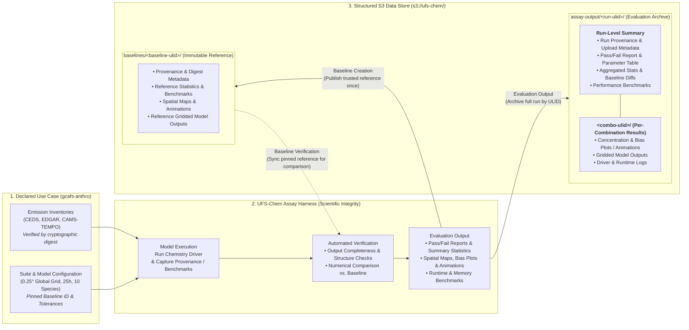

# Spike: high-level Mermaid overview of the `gcafs-anthro` workflow — baseline creation, verification, evaluation output, and the S3 data store layout for scientific integrity

Refined 2026-10-29 from the requirements below: a simple, high-level Mermaid graphic (rendered to PNG via `mermaid-cli` / `mmdc`) showing how the `gcafs-anthro` global anthropogenic emissions use case runs through the harness — covering baseline creation, automated verification, and evaluation output — with the S3 bucket (`s3://ufs-chem/`) shown clearly as a structured, self-describing data store whose hierarchy is immediately adaptable to a web interface without depicting a web UI or low-level filenames.

# session

- **Session ID**: `de68e8bc-b001-4ac6-a1ef-eca67bdf9cd1`
- **Resume Command**: `agy --resume de68e8bc-b001-4ac6-a1ef-eca67bdf9cd1`

## Goal

1. **Communicate why the harness matters for scientific integrity** to a broad scientific and engineering audience — using general, accessible wording without low-level CLI flags, Slurm directives, or specific filenames:
   - **Reproducible inputs & configuration**: declared emission inventories and portable model configuration verified by cryptographic digest before the model runs.
   - **Automated verification & evaluation**: every run executes structural assertions, computes descriptive statistics, renders spatial maps and animations, records runtime/memory benchmarks, and compares numerical fields against a pinned baseline within strict tolerances.
   - **Immutable, auditable provenance in S3**: trusted reference baselines and complete evaluation runs are stored under unique, time-sortable identifiers (ULIDs) with structured metadata, reports, plots, and model outputs.
2. **Make the S3 data store structure self-evident without file-level clutter** so a viewer can see at a glance how the bucket hierarchy (`baselines/<baseline-ulid>/` and `assay-output/<run-ulid>/<combo-ulid>/`) organizes provenance, summary metrics, visual diagnostics, and gridded outputs in a predictable layout adaptable to a web interface.
3. **Deliver a clean Mermaid diagram and PNG render specification** (`20261029-1719-overview.png`) in `design/spike/20261029-1719-overview/`.

## Pre-spike audit (fresh facts, 2026-10-29)

1. **Tooling on machine**: `/opt/homebrew/bin/mmdc` (`mermaid-cli`) is installed and on `PATH`. Notice that `mmdc -i <file>.md -o <file>.png` when given a Markdown input writes `<file>-1.png` (numbering each Mermaid code block in the markdown), whereas piping the extracted Mermaid block (`sed -n '/^```mermaid$/,/^```$/{ /^```/d; p; }' ... | mmdc -i - -o <file>.png -s 2 -b white`) writes directly to the target `.png` without creating any intermediate `.mmd` file.
2. **What the `gcafs-anthro` workflow does at a high level** (`docs/gcafs-anthro-runbook.md`, `design/feat/20261019-1447-global-anthro-use-case/`):
   - **Inputs & Suite Configuration**: global anthropogenic emission datasets (CEDS, EDGAR, CAMS-TEMPO) verified by digest + portable global model configuration (0.25° global grid, 25 hourly steps, 10 species, 32 streams).
   - **Harness Execution**: launches the standalone chemistry driver, captures provenance and resource benchmarks, and runs automated checks.
   - **Three Core Capabilities for Scientific Integrity**:
     1. *Baseline Creation*: a verified reference run is published once to S3 (`baselines/<baseline-ulid>/`) and its identifier is pinned in the suite configuration.
     2. *Verification*: subsequent runs automatically sync the pinned baseline from S3 and verify numerical agreement alongside output completeness and structure checks.
     3. *Evaluation Output*: every run produces a complete, self-contained evaluation package — summary statistics, spatial concentration & bias plots/animations, performance benchmarks, and provenance metadata — archived to S3 (`assay-output/<run-ulid>/`).
3. **S3 Bucket Hierarchy (`s3://ufs-chem/`)**:
   - `baselines/<baseline-ulid>/` — immutable reference snapshot containing provenance & digest metadata, summary statistics & benchmarks, spatial maps & animations, and reference model outputs.
   - `assay-output/<run-ulid>/` — complete evaluation run archive organized into:
     - **Run-Level Summary**: run provenance & metadata, pass/fail test report, aggregated statistics & baseline comparison summaries, and performance benchmarks.
     - **Per-Combination Folder (`<combo-ulid>/`)**: spatial concentration & bias plots/animations, gridded model outputs, and execution logs.
   - Because every run and baseline is keyed by a lexicographically time-sortable ULID and follows this two-level structure, the data store is directly adaptable to a web interface without a backing database.

## Design

### 1. Diagram Structure and Narrative Flow

A single left-to-right (`flowchart LR`) diagram organized into three visual columns (subgraphs):

1. **Column 1 — Declared Use Case (`gcafs-anthro`)**:
   - Digest-verified emission inventories (CEDS, EDGAR, CAMS-TEMPO) + version-controlled suite & model configuration with pinned baseline ID and tolerances.
2. **Column 2 — UFS-Chem Assay Harness (`Scientific Integrity`)**:
   - **Model Execution**: runs the chemistry driver and captures provenance & resource metrics.
   - **Automated Verification**: checks output structure/completeness and performs numerical comparison against the baseline.
   - **Evaluation Output**: generates pass/fail reports, descriptive statistics, spatial maps/bias plots/animations, and runtime/memory benchmarks.
3. **Column 3 — Structured S3 Data Store (`s3://ufs-chem/`)**:
   - Shows the two top-level prefixes (`baselines/<baseline-ulid>/` and `assay-output/<run-ulid>/`) and their conceptual contents (Run-Level Summary + `<combo-ulid>/` Per-Combination Results) without file-level detail.
   - Connects back to the harness via three labeled flows: **Baseline Creation**, **Baseline Verification**, and **Evaluation Output**.

### 2. Mermaid Diagram Source



### 3. Rendering Specification (PNG)

During implementation, render the Mermaid block directly to a high-resolution PNG (`20261029-1719-overview.png`) via `mmdc` stdin so no intermediate files or `-1.png` suffixes are created:

```bash
sed -n '/^```mermaid$/,/^```$/{ /^```/d; p; }' \
    design/spike/20261029-1719-overview/20261029-1719-overview.md \
  | mmdc -i - \
         -o design/spike/20261029-1719-overview/20261029-1719-overview.png \
         -s 2 -b white
```

## Open Questions — Resolved (2026-10-29)

1. **Output image format** — PNG (`20261029-1719-overview.png`).
2. **Level of detail in the S3 subgraphs** — High-level structural categories only; no file-level detail (`run.yaml`, `.csv`, `.nc`, etc. removed).
3. **Verification wording** — General wording kept (`Numerical Comparison vs. Baseline`).

# appendix: original notes

## always do

- include updating design.md as part of the implementation
- update the harness tests (`src/tests/ufs_chem_assay`) in addition to any changes to test_driver_combos.py
- update README.md with any necessary documentation changes in case of an api adjustment
- use pydantic models as opposed to dataclasses
  - all pydantic fields should include a description like `... = Field(description="<description content here>", ...`
- do *not* add driver bugs to known bugs in `README.md` unless explicitly told to do so
- use a test-driven development, red-green-refactor approach for all fixes and features (when possible)
- maintain original design sections when refining design docs - create an appendix
  - summarize conversational updates in the appendix following original refinement target
  - refinements never create files. they only edit the target document that is being refined.
  - `design.md` may be updated during the _implementation_ phase only.
- when using python `typing`, avoid `Any` as much as possible
- **never, ever, ever** commit code or use git actions that perform updates - the user always updates
- always prefer the harness's logging implementation over raw python print statements
- no need for wrapping when writing to the `./design` folder. wrapping will be handled by the user's ide
- persist the agy session id and resume command in any design/refined files for resumability

## session

- **Session ID**: `de68e8bc-b001-4ac6-a1ef-eca67bdf9cd1`
- **Resume Command**: `agy --resume de68e8bc-b001-4ac6-a1ef-eca67bdf9cd1`

### testing

- not necessary for design documents in the `spike` folder - code *should not* change for spikes
- *all* suites should pass `--dry-run`
- run `simple-maccity-suite.yaml` without `--dry-run` for integration testing with the driver
- only run examples when requested to do so
- no need to run tests for spikes/documentation-only tasks
- pre-commit hooks pass

## requirements

- create a simple graphic using mermaid-cli describing how the gcafs-anthro use case is run with elements of baseline creation, verification, and evaluation output.
- include s3 as the data store
- a high-level overview, nothing technically specific
- the purpose is to show the audience why the harness is useful for scientific integrity
- no need to get fancy, focus on the core capabilities
- the data store is easily adaptible to a web interface. don't include the web interface, just make sre the data structure is clear

## conversational updates

- 2026-10-29 (initial refinement): structured the spike around a 3-stage left-to-right Mermaid flowchart (`Declared Use Case` → `UFS-Chem Assay Harness` → `Structured S3 Data Store`) that highlights the three scientific integrity pillars (digest-verified inputs/config, automated baseline verification, and full evaluation artifacts) and depicts the S3 prefix layout (`baselines/<baseline-ulid>/` and `assay-output/<run-ulid>/`). Per the refinement rule ("refinements never create files. they only edit the target document that is being refined"), only `20261029-1719-overview.md` was edited; running `mmdc` to emit the rendered image awaits user review of the diagram and open questions.
- 2026-10-29 (user responses to open questions): (1) PNG output only (`20261029-1719-overview.png`), rendered via `mmdc` stdin so no `-1` suffix or temp file is produced; (2) removed all file-level detail (filenames and extensions) from the S3 subgraphs in favor of high-level structural categories (`Run-Level Summary` and `<combo-ulid>/ (Per-Combination Results)`); (3) kept general wording for the verification node (`Numerical Comparison vs. Baseline`). All open questions resolved.
